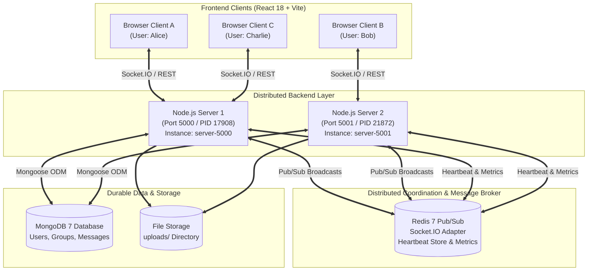
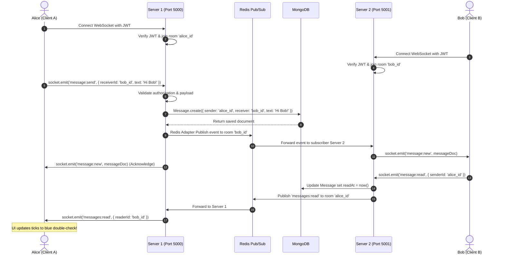

# CHATSPHERE — DISTRIBUTED REAL-TIME MESSAGING SYSTEM
## Advanced Mini Project Report & Viva Reference

**Domain:** Distributed Systems & Full-Stack Web Architecture  
**Project Type:** Multi-Node Real-Time Communication Platform  
**Technology Stack:** React 18, Vite 6, Node.js 24, Express 4, Socket.IO 4, MongoDB 7, Redis 7 (Pub/Sub & Adapter), Docker Compose  

---

## 1. Abstract
**ChatSphere** is a horizontally scalable, production-inspired distributed real-time chat application. It solves the classic multi-server communication challenge: delivering live events to users connected to completely different backend processes across a network. 

The application implements a multi-instance cluster where Node.js servers run concurrently, coordinate state and socket-room broadcasts via a Redis Pub/Sub adapter, and store durable message histories, groups, and user profiles in a shared MongoDB database. ChatSphere features a WhatsApp-inspired interface supporting light/dark themes, direct messaging, multi-user group chat, message replies, emoji reactions, message editing, soft deletion, secure image and document file uploads, unread message badges, and an integrated **Real-Time Cluster Monitor** displaying live server instances, socket loads, memory RSS, and database health.

---

## 2. Problem Statement
In traditional client-server WebSockets architectures, live connections reside entirely in a single server process's RAM. As traffic scales horizontally across multiple servers:
1. **Isolated Connections:** Server 1 cannot natively emit WebSocket packets to a client socket held in Server 2's memory.
2. **State Inconsistency:** Ephemeral status (online presence, typing indicators, read receipts) fails to propagate across nodes.
3. **Cluster Visibility:** Without centralized coordination, administrators lack real-time visibility into node health, connection distributions, and failover state.

ChatSphere addresses these fundamental distributed systems challenges by coupling persistent document storage (MongoDB) with distributed message bus synchronization (Redis Adapter and periodic node heartbeats).

---

## 3. System Architecture



### Architectural Principles Applied:
- **Stateless Application Servers:** Node.js server instances do not maintain exclusive persistent state in memory. Any user can authenticate or connect to any node.
- **Inter-Process Room Routing:** Each user joins a private Socket.IO room `userId`. When Server 1 emits to room `userId`, the Redis Adapter publishes the event payload to a Redis channel; Server 2 receives the subscription event and dispatches it directly to the local socket connection.
- **Dynamic Cluster Discovery:** Every node publishes a heartbeat key `chatsphere:cluster:instance:{id}` in Redis with a 12-second TTL containing port, process ID, memory RSS, and active connection counts.
- **Idempotency & Deduplication:** Messages contain a unique `clientMsgId` generated on the client to prevent duplicate records during network retries.

---

## 4. Database Schema Design (MongoDB)

### 4.1 User Schema (`User.js`)
- `_id`: ObjectId (Primary key)
- `name`: String (2–40 characters, trimmed)
- `email`: String (Unique index, lowercase)
- `passwordHash`: String (bcrypt, salt rounds = 12, hidden from default queries)
- `avatarColor`: String (Hex color code)
- `status`: String (Default "Available", max 100 chars)
- `lastSeen`: Date (Timestamp of latest disconnect)
- `themePreference`: String ('dark' | 'light')
- `createdAt`, `updatedAt`: Date (Automatic timestamps)

### 4.2 Group Schema (`Group.js`)
- `_id`: ObjectId (Primary key)
- `name`: String (2–50 characters, trimmed)
- `description`: String (max 200 characters)
- `avatarColor`: String
- `creator`: ObjectId (Reference -> User, indexed)
- `admins`: Array of ObjectIds (Reference -> User)
- `members`: Array of `{ user: ObjectId, role: 'admin' | 'member', joinedAt: Date }` (Indexed: `members.user`)
- `lastMessage`: `{ text: String, sender: ObjectId, senderName: String, createdAt: Date }`

### 4.3 Message Schema (`Message.js`)
- `_id`: ObjectId (Primary key)
- `sender`: ObjectId (Reference -> User, indexed)
- `receiver`: ObjectId (Reference -> User, nullable for group messages, indexed)
- `group`: ObjectId (Reference -> Group, nullable for direct messages, indexed)
- `conversationType`: String ('direct' | 'group', indexed)
- `text`: String (max 4000 chars)
- `attachments`: Array of `{ url, filename, originalName, mimeType, size }`
- `replyTo`: ObjectId (Reference -> Message, populated for quoted replies)
- `reactions`: Array of `{ user: ObjectId, emoji: String, createdAt: Date }`
- `isEdited`: Boolean (Default false)
- `editedAt`: Date (Nullable)
- `isDeleted`: Boolean (Default false, soft deletion)
- `deliveredAt`: Date (Timestamp when recipient socket was active)
- `readAt`: Date (Timestamp when recipient opened conversation)
- `readBy`: Array of `{ user: ObjectId, readAt: Date }` (Group read tracking)
- `clientMsgId`: String (Unique sparse index for deduplication)

---

## 5. Distributed Message Flow



---

## 6. Main Modules & Implemented Features

| Module | Implemented Features |
|---|---|
| **WhatsApp-Inspired UI** | Dark & Light theme toggle, responsive layout with mobile back navigation, filter tabs (All, Unread, Groups), unread counter badges, timestamp formatting, date separators, empty states, and toast notifications. |
| **Real-Time Direct Chat** | Bi-directional socket communication, typing indicators with debounce, sent (✓), delivered (✓✓ grey), and read (✓✓ blue) receipts, live presence tracking. |
| **Group Chat Management** | Group creation modal with member picker, group administration, real-time broadcast to group rooms, participant info drawer, leave group functionality. |
| **Rich Message Interactions** | Quoted replies, emoji reactions (`👍`, `❤️`, `😂`, `😮`, `😢`, `🙏`), 24-hour message editing with `(edited)` tag, soft delete ("This message was deleted"). |
| **File & Media Sharing** | Secure upload route (`/api/upload`) with multer, 5MB file-size validation, MIME type filtering (JPEG, PNG, WEBP, GIF, PDF, DOCX), thumbnail previews, and document download. |
| **Distributed Architecture** | Dual backend server support (port 5000 & 5001), Redis adapter cross-server routing, automatic heartbeat registration, cluster message counters. |
| **Real-Time Cluster Monitor** | Live UI dashboard querying `/api/system/stats`, showing active instances, process IDs, memory RSS, connected clients per instance, MongoDB & Redis health. |
| **Security & Rate Limiting** | bcrypt hashing (salt rounds = 12), JWT signature verification on HTTP & WebSocket, `express-rate-limit` brute-force protection on auth & upload routes, regex escaping on search. |
| **Automated Testing** | End-to-end integration test (`server/test-distributed.js`) verifying cross-instance messaging across port 5000 and port 5001. |

---

## 7. Verification & Test Results

The automated test script (`npm test` in `server/`) verified cross-instance message delivery across two distinct processes:

```text
=== CHATSPHERE DISTRIBUTED SYSTEM VERIFICATION ===

[Test 1] Verifying server instances health...
✓ Server 1 (server-5000) healthy. Total instances discovered: 2
✓ Server 2 (server-5001) healthy. Total instances discovered: 2
✓ MongoDB Status: connected
✓ Redis Status: connected

[Test 2] Creating / authenticating test accounts...
✓ Alice registered on Server 1 (ID: 6ad8c4b44e148c7820379fc5)
✓ Bob registered on Server 2 (ID: 6ad8c4b57f77d7c2af246487)

[Test 3] Establishing cross-server WebSocket connections...
✓ Alice socket connected to server-5000
✓ Bob socket connected to server-5001

[Test 4] Testing Cross-Server Direct Messaging via Redis Pub/Sub...
✓ Alice server acknowledged send: status ok=true
✓ SUCCESS! Bob (on Server 2) received message via Redis: "Hello Bob from Alice across instances!"
  Message ID: 6ad8c4b64e148c7820379fca, Sender: Alice Distributed

[Test 5] Testing Cross-Server Read Receipt Propagation...
✓ SUCCESS! Alice received read receipt from Bob (Reader ID: 6ad8c4b57f77d7c2af246487) via Redis!

[Test 6] Testing Group Creation and Cross-Server Group Chat...
✓ Group created: "Distributed Systems Group" with ID: 6ad8c4b64e148c7820379fd0
✓ Alice group send acknowledged: ok=true
✓ SUCCESS! Bob received group message on Server 2: "Hello everyone in Distributed Systems Group!"

[Test 7] Verifying Message Persistence in MongoDB...
✓ Message verified in MongoDB durable storage history.

======================================================
🎉 ALL DISTRIBUTED TESTS PASSED PERFECTLY!
======================================================
```

---

## 8. College Viva Demonstration Checklist

When presenting this project to examiners or professors, use this step-by-step checklist:

1. **Architecture & Services Demo:**
   - Run `docker ps` to show MongoDB (port 27017) and Redis (port 6379) running in isolated containers.
   - Show the two Node.js processes running concurrently on ports `5000` and `5001`.
2. **Open the System Monitor Dashboard:**
   - In ChatSphere, click the **Activity / Pulse icon** in the top-left sidebar header.
   - Show the examiner the **Real-time Cluster Monitor**:
     - Point out **Active Backend Nodes: 2 Instances** (`server-5000` and `server-5001`).
     - Point out real process IDs, memory RSS in megabytes, uptime seconds, and live heartbeats.
     - Highlight that MongoDB and Redis statuses are live and `CONNECTED`.
3. **WhatsApp-Inspired UI & Theme Toggle:**
   - Click the **Sun / Moon** icon in the sidebar header to toggle between Dark Theme and Light Theme smoothly.
   - Show conversation filter chips: **All**, **Unread**, and **Groups** with live counter badges.
4. **Cross-Server Real-Time Chat Demonstration:**
   - Open Browser Window 1 (e.g. Chrome) logged in as User A.
   - Open Browser Window 2 (e.g. Incognito or Edge) logged in as User B.
   - Send a message from User A to User B.
   - Show the message instantly appearing in User B's window without page refresh.
   - Point out the delivery ticks changing from single check (sent) to double blue check (read) when User B views the chat.
5. **Advanced Features Demonstration:**
   - **Emoji Reactions:** Hover a message and react with ❤️ or 👍. Show the reaction badge sync in real-time.
   - **Quoted Replies:** Click the reply icon on a message, type a reply, and show the quote banner.
   - **Message Edit / Delete:** Edit an existing message to show the `(edited)` badge, or delete to show "This message was deleted".
   - **Group Chat:** Click the **Plus (+)** button in the sidebar, name a group, select members, and send a group message.
   - **File / Image Sharing:** Click the Paperclip icon, attach an image or PDF, and show the inline image preview or document download card.
6. **Code & Distributed Proof:**
   - Show `server/src/cluster.js` and explain how Redis Adapter and TTL heartbeats work.
   - Run `npm test` in `server/` to execute the automated distributed integration test live in front of the examiner.
